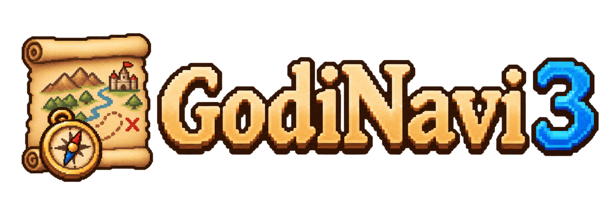

# GodiNavi 3 / ガディナビ 3 / 가디내비 3



> ### [⬇ GodiNavi 3.0.3 Full Download](https://github.com/GD-fandev/godinavi/releases/download/v3.0.3/GodiNavi-3.0.3-Full.zip)

新規利用者の方は、上のリンクからフルバージョンをダウンロードしてください。2.xからは通常のアップデートをご利用いただけます。1.xからの自動移行は終了しました。新しいフォルダーに展開してご利用ください。既存の個人設定は保持されます。

신규 이용자는 위 링크에서 풀버전을 받아 주세요. 2.x는 일반 업데이트로 이용할 수 있습니다. 1.x 자동 이전 지원은 종료했으므로 풀버전을 새 폴더에 압축 해제해 이용해 주세요. 기존 개인 설정은 유지됩니다.

New users should download the full package above. Existing 2.x users can use the normal updater. Automatic migration from 1.x has ended; extract the full package into a new folder. Existing personal settings are preserved.

## 目次 / 목차 / Table of Contents

- [日本語](#日本語)
  - [GodiNaviとは](#godinaviとは)
  - [主な機能](#主な機能)
  - [はじめに](#はじめに)
  - [解説動画](#解説動画)
  - [冒険者様を募集しています](#冒険者様を募集しています)
  - [調査にご協力してくださった冒険者様](#調査にご協力してくださった冒険者様special-thanks)
  - [設定・トラブルシューティング](#設定トラブルシューティング)
  - [ライセンスと注意事項](#ライセンスと注意事項)
- [한국어](#한국어)
  - [가디내비 소개](#가디내비-소개)
  - [주요 기능](#주요-기능)
  - [시작하기](#시작하기)
  - [해설 영상](#해설-영상)
  - [설정 및 문제 해결](#설정-및-문제-해결)
  - [라이선스 및 주의사항](#라이선스-및-주의사항)
- [English](#english)
  - [About GodiNavi](#about-godinavi)
  - [Features](#features)
  - [Getting Started](#getting-started)
  - [Configuration and Troubleshooting](#configuration-and-troubleshooting)
  - [License and Notices](#license-and-notices)

---

## 日本語

### GodiNaviとは

GodiNavi（ガディナビ）は、ガディウスのプレイに必要な便利機能を一つにまとめたゲーム内オーバーレイツールです。

### 主な機能

- ミニマップ・ワールドマップと現在地表示
- 地図上の出入口・町の施設・職業ギルド表示と表示設定
- マップ名・座標・バフ・経験値・耐久度の認識領域の自動設定
- ポータルコマンドの登録・コピーとプリセット管理
- バフタイマーと手動開始モード
- 武器・鎧・盾の耐久度監視と警告
- パーティールームとメンバーの位置表示
- 装備図鑑と染色画像
- 日本語・韓国語・英語UI
- 本体と地図・装備などのデータ更新

### はじめに

1. フルバージョンのZIP全体を展開し、`GodiNavi.exe`を起動してください。実行ファイルだけを移動しないでください。
2. ガディウスを起動するとゲームウィンドウを検出してオーバーレイを表示します。認識領域は自動設定され、ウィンドウのサイズ変更にも追従します。
3. 各ボタンにマウスを合わせるとメニューが開きます。歯車アイコンを左クリックするとメインボタンの位置・サイズを調整できます。
4. 自動認識に問題がある場合は、設定の「手動OCR領域指定」をオンにして領域を調整してください。自動モードの領域表示は確認専用です。
5. ワールドマップは`F10`で開閉できます。バフの手動開始キーは該当機能の設定で確認・変更できます。
6. 詳しい使い方はアプリ内のチュートリアルをご確認ください。

### 地図の使い方

地図アイコンの「地図設定」で地形、移動地点、現在地、施設ラベルや接続線、施設ボタンのサイズを調整できます。

「施設表示」をオンにするとミニマップの上に施設ボタンが表示されます。ギルドボタンにマウスを合わせると、その町の職業ギルド一覧から選択できます。一度に表示できる施設は1種類です。施設選択による自動移動は行いません。

現在地表示は座標情報のある地図に対応します。地図画像が表示されても、座標情報のない地域では現在地が表示されない場合があります。

### 解説動画

- [日本語版 解説動画](https://youtu.be/fcWgLNT3ayk)

旧バージョンの動画です。3.0.1の自動OCRと地図機能はアプリ内のチュートリアルもご確認ください。

### 冒険者様を募集しています

地図画像を新たに整備しました。現在地表示のための座標確認にご協力いただける冒険者様を募集しています。

- 西部背骨洞窟 4～5F
- シャドミュム洞窟 2F・5～6F
- エブリン・エチリン洞窟 2～5F
- ヘル 1～10F

ご協力いただける方や、地図と実際の位置のずれを発見された方は、Discordで制作者までDMをお送りください。ご協力者のお名前は該当地域の地図に表示します。

### 調査にご協力してくださった冒険者様（Special Thanks）

- カリ地下洞窟 9～10F、レゲ地下洞窟 9～10F、シャドミュム洞窟 3～4F、エブリン・エチリン洞窟 1F：狐 様
- イスカルド半島、カールマーニュ洞窟・中部背骨洞窟 2～3F：SERE 様
- カールマーニュ洞窟・中部背骨洞窟 1F：림치 様
- ラリビントス迷路の仕様調査協力：本格炒飯剣士 様
- モンスター名の日本語表記情報提供：セリシア 様
- アンドレアンスーツ・エシールの女性用衣装の染色情報提供：セリシア 様

### 設定・トラブルシューティング

個人設定は次の場所へ保存されます。

```text
%LOCALAPPDATA%\GodiNavi\godinavi-config.json
```

表示言語、OCR範囲、ウィンドウ位置、ミニマップとワールドマップの設定、お気に入り情報などが保存されます。完全に初期化する場合は、ガディナビ終了後にこのファイルをバックアップしてから移動または削除してください。

#### Godius Clientが見つからない

- ゲームが起動中か、最小化されていないか確認してください。
- ゲームを管理者権限で起動している場合、ガディナビにも同等の権限が必要になることがあります。

#### キーボードで移動できない

Godiusとガディナビの互換モードおよび管理者権限の設定が異なる場合、キーボードによる移動ができない、動作が重くなる、フリーズするといった問題が発生することがあります。両方の互換性設定を同じ状態にしてください。

基本的には、管理者権限は両方とも無効にすることを推奨します。GodiusをWindows 8互換モードで実行している場合は、ガディナビにも同じ互換モードを設定してください。

それでも移動キーが反応しない場合は、キャプチャー範囲編集モードを終了してから、左Shift、右Shift、左Ctrl、右Ctrlをそれぞれ一度ずつ押して離すと改善する場合があります。

#### OCRが認識しない、または途切れる

- 認識対象が表示され、メニューなどに隠れていないか確認してください。自動モードでは領域表示で認識範囲を確認できます。
- 自動認識が難しい場合は「手動OCR領域指定」をオンにして調整してください。手動モードではウィンドウサイズ変更後に領域も確認してください。
- マウスオーバー等による短い欠落では、最後の正常なマップを一定時間維持します。

#### ミニマップが表示されない

- 状態欄とOCR結果を確認してください。
- 地図表示を有効にし、本体と地図データを更新してください。現在地表示には該当地域の座標情報が必要です。
- ZIPから配布物全体を展開したか確認してください。

### ライセンスと注意事項

- ガディナビ独自のソースコードは[MIT License](https://github.com/GD-fandev/godinavi/blob/main/LICENSE.txt)で公開しています。
- ゲーム関連素材、地図画像、アイコン等はMIT Licenseの対象外です。詳細は[Asset Notice](https://github.com/GD-fandev/godinavi/blob/main/licenses/ASSET_NOTICE.txt)をご確認ください。
- 旧地図資料の参考・謝辞（ダンジョン）：[Godius公式ホームページ](https://www.godius.co.kr/guide_8?t_id=2)
- 旧地図資料の参考・謝辞（町）：[Godius Online Forum](http://godius.s201.xrea.com/mmain.html)
- 旧地図資料の参考・謝辞（フィールド）：[フィールドマップ](https://www3.hp-ez.com/hp/chombo/field)
- モンスター名の日本語表記情報：[Godius＠モブ表・レアドロ実績表](https://docs.google.com/spreadsheets/d/1HVeLbYElGRoVfSbh26oiRwD-ZGLhCBVE3GfKPZ55Jvc/edit?gid=1783106804#gid=1783106804&fvid=445972214)
- 第三者ソフトウェアとOCRモデルについては[Third-Party Notices](https://github.com/GD-fandev/godinavi/blob/main/licenses/THIRD_PARTY_NOTICES.txt)と`licenses/third_party`をご確認ください。
- ガディナビは非公式ツールです。ゲーム運営方針および素材提供元の規約に従い、各自の判断でご利用ください。

---

## 한국어

### 가디내비 소개

가디내비는 가디우스 플레이에 필요한 편의 기능을 하나로 모은 인게임 오버레이 도구입니다.

### 주요 기능

- 미니맵·월드맵과 현재 위치 표시
- 지도 입구·마을 시설·직업 길드 위치 표시와 표시 설정
- 지도명·좌표·버프·경험치·내구도 인식 영역 자동 설정
- 포탈 명령어 등록·복사 및 프리셋 관리
- 버프 타이머와 수동 시작 모드
- 무기·갑옷·방패 내구도 감시 및 경고
- 파티룸과 파티원 위치 표시
- 장비도감과 염색 이미지
- 한국어·일본어·영어 UI
- 본체와 지도·장비 등 데이터 업데이트

### 시작하기

1. 풀버전 ZIP 전체를 압축 해제한 뒤 `GodiNavi.exe`를 실행하세요. 실행 파일만 따로 옮기지 마세요.
2. 가디우스를 실행하면 게임 창을 찾아 오버레이를 표시합니다. 인식 영역은 자동으로 설정되며 창 크기가 바뀌면 함께 조정됩니다.
3. 각 버튼에 마우스를 올리면 메뉴가 나타납니다. 톱니바퀴 아이콘을 좌클릭하면 메인 버튼의 위치와 크기를 조절할 수 있습니다.
4. 자동 인식에 문제가 있다면 설정의 ‘수동 OCR 영역 지정’을 켜서 직접 조정하세요. 자동 모드의 영역 표시는 확인용이며 이동·크기 변경은 할 수 없습니다.
5. 월드맵은 `F10`으로 열고 닫을 수 있습니다. 버프 수동 시작 키는 해당 기능의 설정에서 확인하거나 변경할 수 있습니다.
6. 자세한 사용 방법은 앱 안의 튜토리얼을 확인해 주세요.

### 지도 사용하기

지도 아이콘의 ‘지도 설정’에서 지형, 이동 지점, 내 위치, 시설 라벨과 연결선, 시설 버튼 크기를 조절할 수 있습니다.

‘시설 표시’를 켜면 미니맵 위에 시설 버튼이 나타납니다. 길드 버튼에 마우스를 올리면 현재 마을의 직업 길드 목록에서 선택할 수 있습니다. 시설은 한 번에 한 종류만 표시할 수 있으며, 선택 시 자동으로 이동하지 않습니다.

현재 위치 표시는 좌표 정보가 있는 지도에서 사용할 수 있습니다. 지도 이미지가 표시돼도 좌표 정보가 없는 지역에서는 현재 위치가 표시되지 않을 수 있습니다.

### 해설 영상

- [한국어판 해설영상](https://youtu.be/eCkEvMEkAuc)

이전 버전 기준 영상입니다. 3.0.1의 자동 OCR과 지도 기능은 앱 안의 튜토리얼도 확인해 주세요.

### 지도 조사와 자료 제공에 감사드립니다

현재 위치 표시용 좌표 확인이 더 필요한 지역은 다음과 같습니다.

- 서부등뼈동굴 4–5층
- 샤드뮴동굴 2층·5–6층
- 에블린동굴·에칠린동굴 2–5층
- 헬 1–10층

조사에 협력하시거나 위치 오류를 발견하셨다면 Discord에서 제작자에게 DM으로 알려 주세요. 기여자 이름은 해당 지역의 지도에 표시합니다.

- 칼리 지하동굴 9–10층, 레게 지하동굴 9–10층, 샤드뮴동굴 3–4층, 에블린동굴·에칠린동굴 1층: 狐 님
- 이스칼드 반도, 카를마뉴 동굴·중부등뼈동굴 2–3층: SERE 님
- 카를마뉴 동굴·중부등뼈동굴 1층: 림치 님
- 라비린토스미로 사양 조사 협력: 本格炒飯剣士 님
- 몬스터명 일본어 표기 정보 제공: セリシア 님
- 안도레안 수트·에시르 여자옷 염색정보 제공: セリシア 님

### 설정 및 문제 해결

개인 설정은 다음 위치에 저장됩니다.

```text
%LOCALAPPDATA%\GodiNavi\godinavi-config.json
```

표시 언어, OCR 영역, 창 위치, 미니맵과 월드맵 설정, 즐겨찾기 정보 등이 저장됩니다. 완전히 초기화하려면 가디내비를 종료한 뒤 이 파일을 백업하고 이동하거나 삭제하세요.

#### Godius Client를 찾을 수 없는 경우

- 게임이 실행 중인지, 최소화되어 있지는 않은지 확인하세요.
- 게임을 관리자 권한으로 실행했다면 가디내비에도 같은 권한이 필요할 수 있습니다.

#### 키보드로 이동할 수 없는 경우

Godius와 가디내비의 호환 모드 또는 관리자 권한 설정이 서로 다르면 키보드 이동이 되지 않거나, 동작이 느려지거나, 프로그램이 멈추는 문제가 발생할 수 있습니다. 두 프로그램의 호환성 설정을 동일하게 맞추세요.

기본적으로 두 프로그램 모두 관리자 권한을 사용하지 않는 것을 권장합니다. Godius를 Windows 8 호환 모드로 실행한다면 가디내비에도 같은 호환 모드를 설정하세요.

그래도 이동 키가 반응하지 않으면 캡처 영역 편집 모드를 종료한 뒤 왼쪽 Shift, 오른쪽 Shift, 왼쪽 Ctrl, 오른쪽 Ctrl 키를 각각 한 번씩 눌렀다가 떼어 보세요.

#### OCR이 인식되지 않거나 끊기는 경우

- 인식할 정보가 화면에 표시되고 메뉴 등에 가려지지 않았는지 확인하세요. 자동 모드의 영역 표시에서 인식 범위를 확인할 수 있습니다.
- 자동 인식이 어렵다면 ‘수동 OCR 영역 지정’을 켜서 조정하세요. 수동 모드에서는 창 크기 변경 후 영역도 다시 확인하세요.
- 마우스 오버 등으로 잠시 인식이 끊기면 마지막으로 정상 인식된 지도를 일정 시간 유지합니다.

#### 미니맵이 표시되지 않는 경우

- 상태 표시와 OCR 결과를 확인하세요.
- 지도 기능을 켜고 본체와 지도 데이터를 업데이트하세요. 현재 위치 표시에는 해당 지역의 좌표 정보가 필요합니다.
- ZIP 배포본 전체를 압축 해제했는지 확인하세요.

### 라이선스 및 주의사항

- 가디내비 고유 소스 코드는 [MIT License](https://github.com/GD-fandev/godinavi/blob/main/LICENSE.txt)로 공개됩니다.
- 게임 관련 리소스, 지도 이미지, 아이콘 등은 MIT License 적용 대상이 아닙니다. 자세한 내용은 [Asset Notice](https://github.com/GD-fandev/godinavi/blob/main/licenses/ASSET_NOTICE.txt)를 확인하세요.
- 기존 지도 자료의 출처와 감사 안내 — 던전: [Godius 공식 홈페이지](https://www.godius.co.kr/guide_8?t_id=2)
- 기존 지도 자료의 출처와 감사 안내 — 마을: [Godius Online Forum](http://godius.s201.xrea.com/mmain.html)
- 기존 지도 자료의 출처와 감사 안내 — 필드: [필드맵](https://www3.hp-ez.com/hp/chombo/field)
- 제3자 소프트웨어와 OCR 모델은 [Third-Party Notices](https://github.com/GD-fandev/godinavi/blob/main/licenses/THIRD_PARTY_NOTICES.txt) 및 `licenses/third_party`를 확인하세요.
- 가디내비는 비공식 도구입니다. 게임 운영 정책과 리소스 제공처의 약관을 준수하고 각자의 판단과 책임에 따라 사용하세요.

---

## English

### About GodiNavi

GodiNavi is an in-game overlay that brings together useful tools for playing Godius.

### Features

- Minimap, world map, and current-position display
- Configurable entrance, exit, town facility, and class guild markers
- Automatic recognition region setup for map names, coordinates, buffs, experience, and durability
- Portal command registration, copying, and preset management
- Buff timer with a manual start mode
- Weapon, armor, and shield durability monitoring and warnings
- Party rooms and party member locations
- Equipment catalog and dye images
- Japanese, Korean, and English UI
- Application, map, equipment, and other data updates

### Getting Started

1. Extract the entire full-package ZIP and run `GodiNavi.exe`. Do not move the executable on its own.
2. Start Godius. GodiNavi detects the game window and displays its overlays. Recognition regions are set automatically and follow window resizing.
3. Hover over a button to open its menu. Left-click the gear icon to adjust the main toolbar position and size.
4. If automatic recognition is unreliable, enable “Manual OCR regions” in Settings to adjust the regions yourself. Automatic region previews cannot be moved or resized.
5. Press `F10` to open or close the world map. Check or change manual buff start keys in the corresponding settings.
6. Read the in-app tutorials for detailed instructions.

### Using Maps

Open “Map settings” from the map icon to adjust terrain, exits, your position, facility labels and leader lines, and facility button size.

Enable “Facility markers” to show buttons above the minimap. Hover over Guild to select a class guild in the current town. Only one facility type can be displayed at a time. Selecting a facility does not move your character automatically.

Current-position display requires coordinate data. A map image may be available even when current-position display is not supported.

### Map Research and Contributions

We welcome help verifying coordinates for current-position display in these areas:

- Western Spine Cave, floors 4–5
- Shadmyoom Cave, floors 2 and 5–6
- Evlin and Echilin Caves, floors 2–5
- Hell, floors 1–10

To help with research or report incorrect positions, please DM the creator on Discord. Contributors are credited on the relevant maps.

- Kali Underground Cave floors 9–10, Rege Underground Cave floors 9–10, Shadmyoom Cave floors 3–4, and Evlin and Echilin Caves floor 1: 狐
- Iskald Peninsula, Karlmannu Cave and Central Spine Cave floors 2–3: SERE
- Karlmannu Cave and Central Spine Cave floor 1: 림치
- Laribintos Maze mechanics research: 本格炒飯剣士
- Japanese monster name information: セリシア
- Dye information for the female Andorrean Suit and Aesir: セリシア

### Configuration and Troubleshooting

Your personal settings are stored at:

```text
%LOCALAPPDATA%\GodiNavi\godinavi-config.json
```

This file stores settings such as the display language, OCR regions, window positions, minimap and world map preferences, and favorites. To reset GodiNavi completely, close the application, back up this file, and then move or delete it.

#### Godius Client cannot be found

- Make sure the game is running and is not minimized.
- If the game is running as administrator, GodiNavi may need the same privileges.

#### Keyboard movement does not work

If Godius and GodiNavi use different compatibility-mode or administrator settings, keyboard movement may stop working, performance may degrade, or the applications may freeze. Configure both applications with the same compatibility settings.

We generally recommend disabling administrator privileges for both applications. If Godius runs in Windows 8 compatibility mode, configure GodiNavi to use the same mode.

If the movement keys still do not respond, exit capture-region editing mode, then press and release Left Shift, Right Shift, Left Ctrl, and Right Ctrl once each.

#### OCR does not recognize text or recognition is intermittent

- Make sure the information is visible and not covered by menus. In automatic mode, open the region preview to check the recognized area.
- If automatic recognition is unreliable, enable “Manual OCR regions” and adjust the regions. In manual mode, check them again after resizing the game window.
- For brief recognition gaps caused by mouse hover or similar events, GodiNavi keeps the last successfully recognized map for a short time.

#### The minimap is not displayed

- Check the status display and OCR results.
- Enable the map feature and update the application and map data. Current-position display requires coordinate data for that area.
- Make sure you extracted the entire ZIP distribution.

### License and Notices

- GodiNavi's original source code is available under the [MIT License](https://github.com/GD-fandev/godinavi/blob/main/LICENSE.txt).
- Game-related assets, map images, icons, and similar materials are not covered by the MIT License. See the [Asset Notice](https://github.com/GD-fandev/godinavi/blob/main/licenses/ASSET_NOTICE.txt) for details.
- Earlier map references and acknowledgements — dungeons: [Official Godius website](https://www.godius.co.kr/guide_8?t_id=2)
- Earlier map references and acknowledgements — towns: [Godius Online Forum](http://godius.s201.xrea.com/mmain.html)
- Earlier map references and acknowledgements — fields: [Field Map](https://www3.hp-ez.com/hp/chombo/field)
- For third-party software and OCR models, see the [Third-Party Notices](https://github.com/GD-fandev/godinavi/blob/main/licenses/THIRD_PARTY_NOTICES.txt) and `licenses/third_party`.
- GodiNavi is an unofficial tool. Follow the game operator's policies and the terms of the asset providers, and use it at your own discretion and responsibility.
